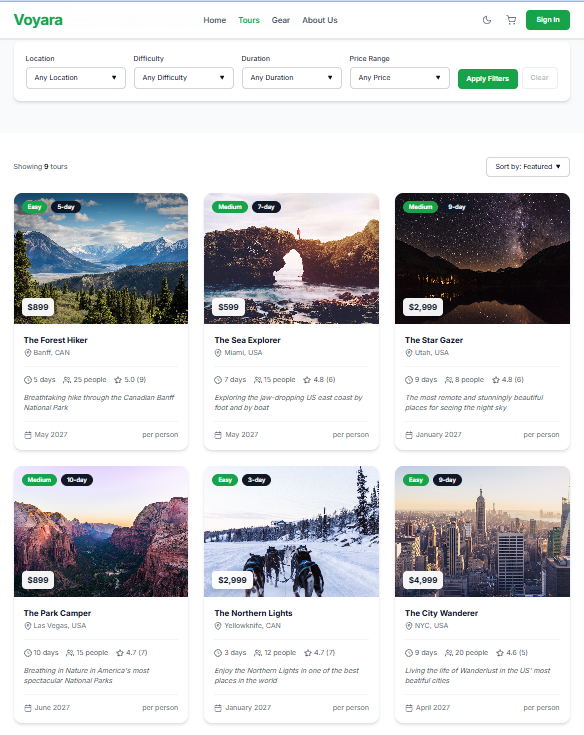
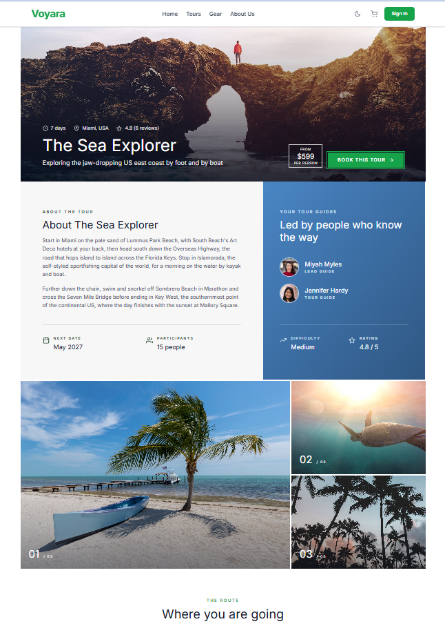
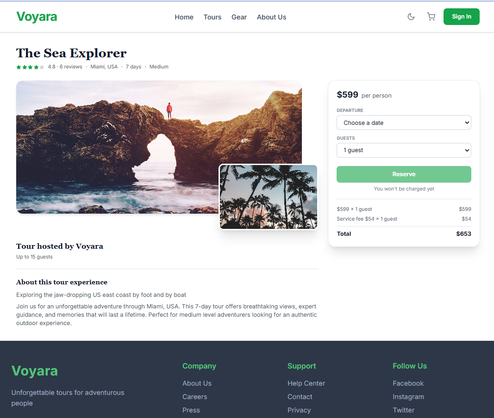
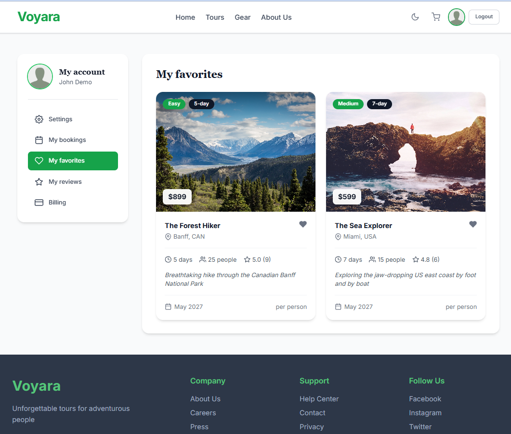

# Voyara - full-stack travel booking app

A tour-booking and outdoor-gear shop, built end to end in TypeScript: React
frontend, Node/Express API, MongoDB, Stripe payments, Mapbox maps, Docker,
and a GitHub Actions pipeline that deploys to Fly.io.

**Live demo:** https://john-v.dev

| Demo login | |
|---|---|
| Email | `demo@john-v.dev`|
| Password | `Welcome12*` |

Payments run in Stripe **test mode** - pay with card `4242 4242 4242 4242`,
any future date, any CVC. No real money moves.

> The source code is in a private repository. I'm happy to walk through it or
> grant read access on request - contact details at the bottom.

## Screenshots

| Tours | Tour details with route map |
|---|---|
|  |  |
| **Checkout** | **My account** |
|  |  |

---

## What you can do in the app

- **Browse tours** - filter by location, difficulty, duration and price; sort
  by price or rating. Readable URLs (`/tour/the-sea-explorer`).
- **Tour details** - gallery, guides, reviews, and a Mapbox map with each stop
  numbered by day and the driving route between them.
- **Book a tour** - pick a date and the number of guests (with a per-guest
  service fee), then pay through Stripe Checkout.
- **Gear shop** - add jackets, backpacks, skis and goggles to a cart that works
  for guests (kept in the browser) and syncs to the account after login; pay
  through Stripe.
- **Accounts** - sign up, log in, reset a forgotten password; "My account"
  with settings, bookings, favourites and reviews.
- **Reviews** - only travellers who booked a tour can review it.
- **Light and dark theme.**

## Tech stack

| Area | Tools |
|---|---|
| Frontend | React 19, TypeScript, Redux Toolkit + RTK Query, React Router 7, Tailwind CSS 4, Vite |
| Maps | Mapbox GL via react-map-gl, Mapbox Directions for driving routes |
| Backend | Node 22, Express, TypeScript, Mongoose 8 (MongoDB Atlas) |
| Auth & security | JWT, bcrypt, Helmet, rate limiting, NoSQL-injection sanitising, HPP, CORS allow-list |
| Payments & email | Stripe Checkout, Nodemailer + SendGrid with Pug templates |
| Images | Multer uploads, resized with Sharp |
| Testing | Vitest + Testing Library (frontend), Jest + Supertest (backend), MongoDB integration tests |
| DevOps | Docker (multi-stage builds), docker compose, GitHub Actions, Fly.io, nginx |

## Architecture

```
 Browser ──► nginx (Fly: web app) ── static React build
    │
    └──── HTTPS / JSON ──► Express API (Fly: API app) ──► MongoDB Atlas
                                │
                                ├──► Stripe Checkout
                                └──► SendGrid (email)
```

- The React app is a static build served by nginx; the API address is baked in
  at build time (`VITE_API_URL`), so one image is built per environment.
- The API is stateless (JWT), so Fly can stop and start machines freely; a
  `/health` route lets Fly restart an unhealthy machine.
- Secrets live only in Fly secrets and GitHub secrets - never in the repo or
  an image layer.

## Quality and delivery

**Tests - about 650 in total**

- Frontend: 35 test files, 214 tests - pages, hooks, Redux slices, the map,
  checkout flows. API calls are mocked at `fetch`, so tests run offline.
- Backend: 44 test files, 439 tests - every route, the error handler, auth,
  rate limits, and a dedicated **NoSQL-injection suite**; plus integration
  tests against a real MongoDB.

**CI/CD pipeline (GitHub Actions)**

```
 lint (backend) ─┐
 lint (frontend) ┤
 npm audit       ┼─► build ─► deploy API / deploy web  (manual button only)
 tests (backend) ┤
 tests (frontend)┤
 docker build x2 ┘
```

- Six independent checks run in parallel on every push and pull request.
- Deploys are **manual and gated**: the deploy button re-runs every check on
  `main` and deploys only if all of them pass. Merging never deploys by itself.
- The backend tests run against a throwaway MongoDB service container.
- Both Docker images are built in CI, so a broken Dockerfile shows up before
  deploy day.
- `npm audit` of production dependencies: 0 known vulnerabilities.

## Engineering decisions worth discussing

- **One route for id or slug** - `GET /tours/:idOrSlug` treats a 24-character
  hex value as a MongoDB id and anything else as a slug, so pages get readable
  URLs while bookings and reviews keep stable ids.
- **Error handling** - database and token errors are turned into clear
  4xx responses; the public only ever sees fixed messages, details go to logs.
- **Tests that don't depend on the developer's machine** - fixed time zone,
  placeholder tokens and a mock API port, so CI and a fresh clone behave the
  same.
- **Small images** - the API image is built with the full toolchain, then
  copied into a slim runtime running as a non-root user; the web image is
  unprivileged nginx with long-term caching for hashed assets.

## Run it locally (with access to the code)

```bash
cp backend/.env.example backend/.env    # fill in MongoDB, JWT, Stripe values
docker compose up --build
# web  http://localhost:8080
# api  http://localhost:3000/health
```

## Roadmap

- Stripe webhook, so bookings and gear orders are recorded after payment
- Email templates bundled into the production image
- Owner checks on editing and deleting reviews

---

**John V** - <!-- TODO: email / LinkedIn / GitHub --> - https://john-v.dev
